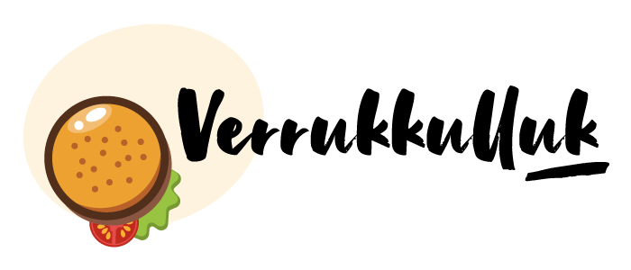

# Verrukkuluk 
Gegeven is een recepten website die door een grote supermarktketen als extra service- en verkoopkanaal wordt ingezet. Alle artikelen die in de recepten gebruikt worden, zijn in de filialen van de supermarkt te verkrijgen.

> lees de opdracht beschrijving op https://e-learning.educom.nu/cases/verrukkulluk/intro

## Opdracht
Vervaardig een gegevensmodel op basis van bovenstaande informatie en scherm-mockups in twee fases: 
1. Fase 1: De back-end
2. Fase 2: De front-end

> Hanteer de planning in je project-overzicht

## Fase 1 - De Back-end
In deze fase programeer je alles wat met het ophalen van de gerechten te maken
heeft, ook het maken en het bijwerken van de boodschappenlijst en de favorieten ga je nu vervaardigen.


## Fase 2 - De front-end

De startup-code van **Fase 2** vind je in de <a href='./fase-2/'>Fase 2 directory</a>
Kopieer de `index.php` naar de root van je project en pas hem aan zodat je eigen classes aangeroepen worden.

Aangezien er in de moderne tijd nog zelden zonder framework gewerkt wordt - 
zowel voor frontend development of backend ontwikkeling - gaan we in deze case 
ook alvast aan de slag met een zogenaamde [template engine](https://en.wikipedia.org/wiki/Template_processor). 
Dit is een stukje code dat ontwikkeld is om het leven van een developer wat 
aangenamer te maken. 

Open je command line interface. in windows start je deze door: 

`Start -> Uivoeren -> cmd`

Mogelijk dat je je zogenaamde [PATH moet instellen](https://www.computerhope.com/issues/ch000549.htm).
We gaan hier nu niet uitleggen wat dat precies betekent, 
in dit geval is [Google](https://www.google.com/search?ei=mKaiXovxO8eykwXxjJDYDQ&q=what+is+the+path+in+dos+or+windows+10&oq=what+is+the+PATH+in+dos+or+windo&gs_lcp=CgZwc3ktYWIQAxgBMggIIRAWEB0QHjIICCEQFhAdEB4yCAghEBYQHRAeMggIIRAWEB0QHjIICCEQFhAdEB4yCAghEBYQHRAeMggIIRAWEB0QHjoECAAQRzoECAAQQzoCCAA6BQgAEJECOgYIABAWEB5QwBZYq2JgoWtoA3AGeACAAWeIAZMSkgEEMzQuMZgBAKABAaoBB2d3cy13aXo&sclient=psy-ab) your friend.

### Twig
De template engine die we nu gaan gebruiken is [twig](https://twig.symfony.com). 
Deze gaan we in het Symfony  project (Symfony) ook inzetten.
Er zijn nog wel een aantal, zoals bijvoorbeeld [Smarty](https://www.smarty.net/) 
maar die werkt in grote lijnen hetzelfde.  

Je kunt twig nu via composer toevoegen aan de je project. 
Open hier toe een command prompt en type de volgende commando's:

### Windows
```shell
cd \directory\van\project [ENTER\
```

### Mac / Linux
```shell
cd directory/van/project [ENTER]
```

**NB:** `directory/van/project` moet je uiteraard vervangen door de **ECHTE** naam(en) van
de directory's van je project...

Installeer nu vanuit deze directory (de "root" van je project) twig met composer: 

```shell
composer require twig/twig
```

Eventueel:
```shell
php composer require twig/twig
```

### Project
Dit "skeleton" project is een eenvoudige instructie hoe je met twig kunt werken. 
Kijk voor meer informatie en uitgebreide documentatie op de [twig site](https://twig.symfony.com)

## Case brief and functional requirements

Verrukkulluk is a supermarket-backed recipe website. Visitors can submit recipes, rate recipes anonymously from one to five stars, and add comments using a hardcoded user ID (login itself is out of scope). Recipe calories and total price for four people are calculated from product information and ingredient quantities.

The homepage lists recipes newest first. Each recipe card shows its photo, dish type, cuisine, title, rating, short description (up to four lines), a link to the recipe, calories, and price for four people. The recipe detail page shows its description, cuisine, type, contributor's first name, and submission date. It also provides favorites and shopping-list actions, plus tabs for ingredients, preparation steps, and visitor comments.

The shopping list combines matching products across selected recipes, calculates a cost-efficient quantity, and lets visitors remove individual items. Agenda, login, and footer are hardcoded for this phase. Use the supplied mockups as the design and interaction reference; the embedded prototype is linked on the source Mock-ups page.

## Delivery sequence

Follow the repository's standard workflow and project schedule. Complete and get approval for each task before beginning the next, and raise schedule risks early. Apply the general delivery criteria, then create a normalized ERD from the mockups, define the transaction model and its arguments, prepare an Application Structure Diagram, and implement the backend followed by the frontend. The original README's two-phase instructions and Twig/Symfony setup notes remain above; the existing PHP/Twig starter files and algorithm PDF are retained.

## Design system and included references

Use Pretty Lily for headings and Arial for body text. Reference heading sizes are 42px, 32px, 22px, and 18px; body text is 14px. Brand colors: `#402214`, `#774231`, `#AA4B1B`, `#B31714`, `#DC3439`, `#FFF0D6`, `#EB8D1F`, `#FCA01F`, `#6E8722`, `#95B82D`, black, and white. Local case reference downloads are in `assets/case-reference/`; existing site assets are preserved in `assets/`. The added compliance workflow is `.github/workflows/compliance.yml`, with its checker in `scripts/check-compliance.zsh`.

Source pages: [Introduction](https://e-learning.educom.nu/cases/verrukkulluk/intro), [Mock-ups](https://e-learning.educom.nu/cases/verrukkulluk/mockups), [Assignments](https://e-learning.educom.nu/cases/verrukkulluk/opdrachten), and [Assets](https://e-learning.educom.nu/cases/verrukkulluk/assets).
